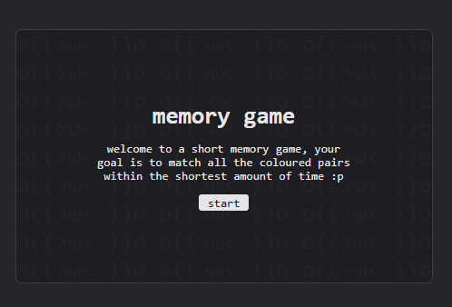
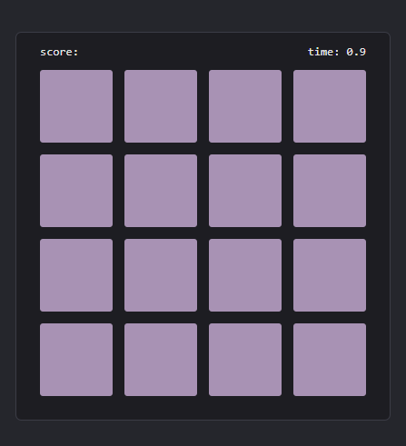
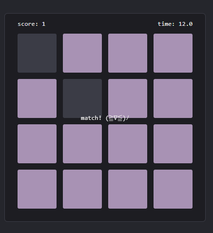
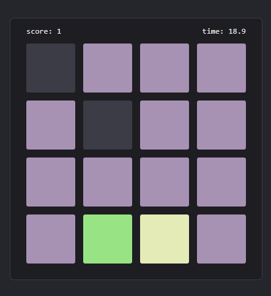
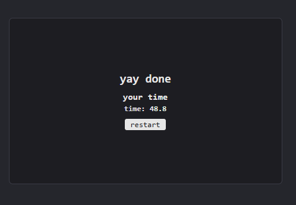

# memory game
13/05/26
vanilla html, css, js memory matching game :p

## img

## improvements
- make finish screen cuter
- local storage record system where user can input a name at the beginning of each game and work towards the best time
- icon or images rather than just colours on the cards

## notes
happy with this project :p